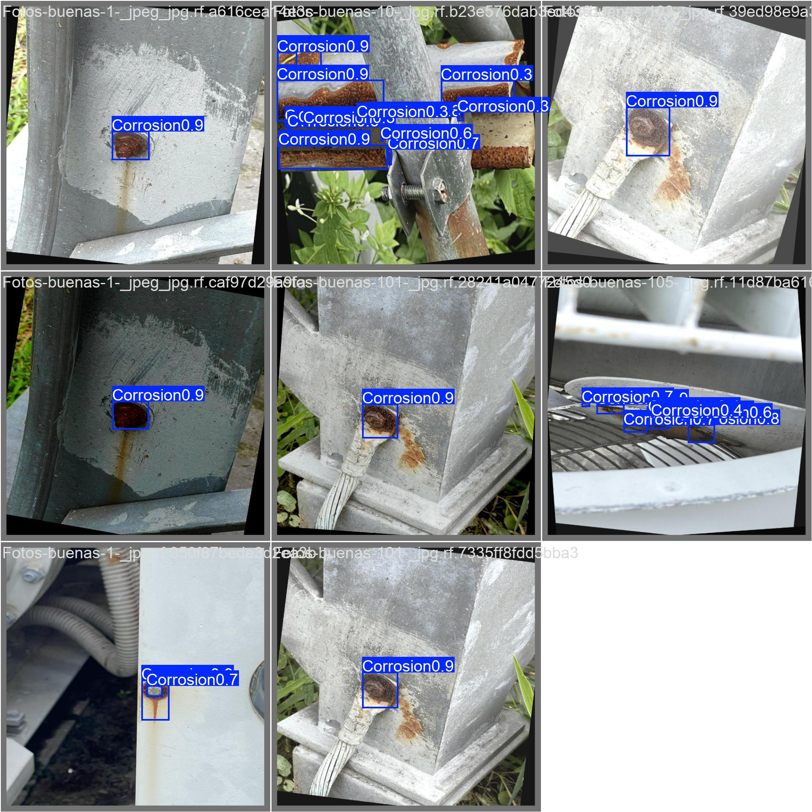

# Rust detector

Detects corrosion (rust) on metal surfaces in photos with a YOLOv10s model trained on a Roboflow dataset.

The repo has two parts:

- **Training code** (`train.py`, `test_corrosion.py`) and the trained weights.
- **A website** in `public/` that runs the model in the browser with [ONNX Runtime Web](https://onnxruntime.ai/docs/tutorials/web/). Upload a photo and the corroded areas are boxed. Nothing is uploaded to a server, so it deploys to Vercel as a plain static site.



## Results

YOLOv10s, 30 epochs, 640 px, batch 4. Final epoch on the validation set:

| Precision | Recall | mAP@50 | mAP@50-95 |
|-----------|--------|--------|-----------|
| 0.943     | 0.821  | 0.886  | 0.710     |

Training curves and confusion matrices are in `runs/detect/runs/corrosion/yolov10s/`; the test-set evaluation plots are in `runs/detect/val/`.

## Project layout

```
train.py                 train YOLOv10s on the dataset
test_corrosion.py        evaluate best.pt on the test split
export_onnx.py           convert best.pt to ONNX for the website
data.yaml                dataset config (1 class: Corrosion)
yolov10s.pt              pretrained base weights
runs/detect/runs/corrosion/yolov10s/weights/best.pt   trained model
public/                  the website (index.html, app.js, model/best.onnx, ort/)
vercel.json              tells Vercel to serve public/
```

## Get the dataset

The images are not in this repo. Download **Corrosion YOLOv8, version 1** from Roboflow in YOLOv8 format and unzip it so `train/`, `valid/` and `test/` sit next to `data.yaml`:

https://universe.roboflow.com/kevin-benz/corrosion-yolov8-nuobv/dataset/1

## Train and evaluate

```bash
python -m venv .venv
.venv\Scripts\activate          # Windows; use source .venv/bin/activate on macOS/Linux
pip install -r requirements.txt

python train.py                 # needs a CUDA GPU (device=0)
python test_corrosion.py
```

After retraining, update the website's model:

```bash
python export_onnx.py
```

## Run the website locally

Any static server works, for example:

```bash
cd public
python -m http.server 8000
```

Then open http://localhost:8000.

## Deploy to Vercel

1. In Vercel, choose **Add New → Project** and import this GitHub repo.
2. Leave the framework preset as **Other** and the build settings empty. `vercel.json` already points Vercel at `public/`.
3. Deploy. Every push to `main` redeploys automatically.

`vercel.json` also sends the headers that let the model use several CPU threads, and `.vercelignore` keeps the training files out of the deployment.

## Credits and licences

- Dataset: [Corrosion YOLOv8](https://universe.roboflow.com/kevin-benz/corrosion-yolov8-nuobv) on Roboflow Universe, CC BY 4.0.
- Model and training: [Ultralytics](https://github.com/ultralytics/ultralytics) YOLOv10, AGPL-3.0.
- Browser inference: [ONNX Runtime Web](https://github.com/microsoft/onnxruntime), MIT.
